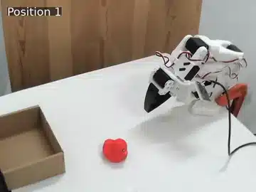
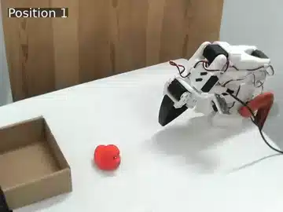
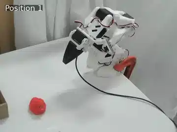
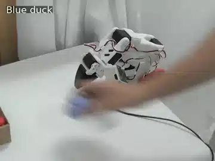
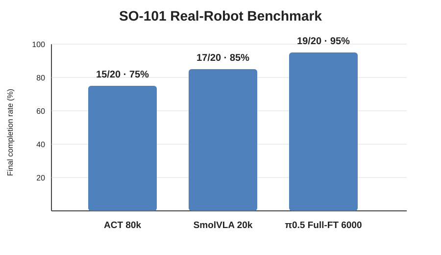
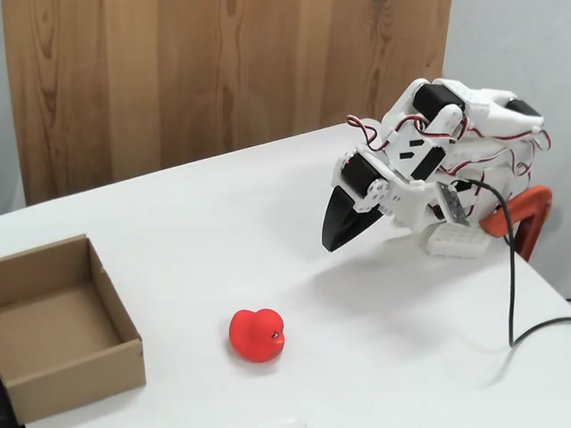
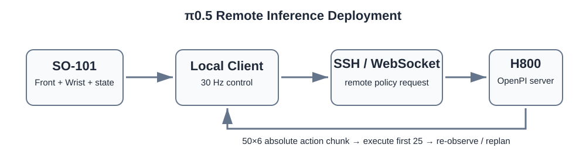

# SO-101 多模型 VLA 真机 Benchmark

基于同一套 **SO-101 + Front/Wrist 双相机**平台和同一份 Final50 数据，对 **ACT、SmolVLA、π0.5** 完成训练/微调、真机部署和统一 20 次测试。

任务：**从桌面抓取红色目标并放入盒子**。

| 项目 | 配置 |
|---|---|
| Robot | SO-101 Leader / Follower |
| Cameras | Front + Wrist |
| Dataset | Final50：50 episodes / 14,753 frames |
| Task | Pick up the red object and place it into the box. |
| Models | ACT / SmolVLA / π0.5 |

三种模型使用同一硬件、同一任务和同一份冻结数据，尽量把差异收敛到模型本身和部署方式。正式结果统一按最终是否把目标放入盒子统计。

---

## Demo

展示不同桌面位置下的 **接近目标 → 抓取 → 搬运 → 放入盒子** 完整过程。点击动图可查看完整 MP4。

<table>
<tr>
<td align="center"><b>ACT</b> </td>
<td align="center"><b>SmolVLA</b> </td>
<td align="center"><b>π0.5</b> </td>
</tr>
</table>

### π0.5 未见物体测试

额外测试了更小的蓝紫色小鸭和胶带类物体，展示未见物体下的定位、抓取和放置过程。

蓝紫色小鸭尺寸更小，实际测试中更容易出现抓取失败；胶带类物体可以完成抓取和放置。目标外观和位置变化时，π0.5 仍能继续执行任务，但尺寸和几何形状变化会明显影响 grasp pose、contact point 和夹爪闭合。

详细记录见 [`docs/ood_evaluation.md`](docs/ood_evaluation.md)。

---

## 真机结果

每个模型执行 20 次测试，以**最终是否将目标放入盒子**作为成功判据。

| 模型 | Checkpoint | 完成率 |
|---|---:|---:|
| ACT | 80k | **15/20（75%）** |
| SmolVLA | 20k | **17/20（85%）** |
| π0.5 | 6000 updates / dir 5999 | **19/20（95%）** |

  

> 三组测试使用同一平台、同一任务和同一数据集；测试位置并非逐点一一对应。

从失败分布看，三个模型的主要问题也在发生变化：ACT 的失败更多出现在桌面内部局部 weak region；SmolVLA 对内部位置覆盖更好，剩余问题逐渐向工作空间边界和 reach/contact limit 转移；π0.5 在正式 20 次测试中只剩 1 次极端边界失败。

---

## 硬件与任务

  

机器人输入为 Front + Wrist 两路 RGB 图像和 6D 关节状态，输出 6D 关节动作。

| 组件 | 配置 |
|---|---|
| Robot | SO-101 Leader / Follower |
| Leader | 5 V |
| Follower | 12 V |
| Cameras | Front + Wrist |
| Resolution | 640×480 @ 30 FPS |
| State / Action | 6D / 6D |
| Local | Ubuntu 22.04 + RTX 3060 Laptop 6 GB |
| π0.5 | H800 80 GB |

正式测试使用 `/dev/serial/by-id/` 和 `/dev/v4l/by-id/` 固定机械臂与相机设备路径，避免 USB 编号变化导致串口或视频设备错位。Front 相机提供全局桌面视角，Wrist 相机提供末端局部视觉。

更多硬件记录见 [`docs/hardware.md`](docs/hardware.md)。

---

## Final50 数据集

三种模型统一使用冻结后的 Final50。

| 项目 | 数值 |
|---|---:|
| Episodes | **50** |
| Frames | **14,753** |
| FPS | **30** |
| Cameras | Front + Wrist |
| Image (H×W) | 480×640 |
| State / Action | 6D / 6D |

数据来自多位置遥操作。录制后逐条检查 episode，删除明显异常、动作不完整或不适合作为示范的数据，再补录至 50 条后冻结版本。ACT、SmolVLA 和 π0.5 后续均使用这同一份数据，避免模型对比被不同数据质量干扰。

任务文本：

~~~text
Pick up the red object and place it into the box.
~~~

详细记录见 [`docs/dataset.md`](docs/dataset.md)。

---

## ACT

- Checkpoint：**80k**
- Batch size：8
- Dataset：Final50
- 真机结果：**15/20**

ACT 训练到 100k，并保存 20k / 40k / 60k / 80k / 100k checkpoint。最终 checkpoint 不按最低 training loss 直接决定，而是结合真机 rollout 表现筛选，正式 Benchmark 使用 80k。

ACT 已经能稳定完成大部分桌面抓取，但失败更容易集中在局部位置，主要表现为抓取点偏差、夹爪闭合位置不理想和抓取稳定性不足。

配置：[`configs/act.yaml`](configs/act.yaml)  
Checkpoint 记录：[`docs/checkpoint_selection.md`](docs/checkpoint_selection.md)

---

## SmolVLA

- Base model：`lerobot/smolvla_base`
- Training：20k steps
- Batch size：32
- Seed：1000
- 真机结果：**17/20**

相对 ACT，SmolVLA 对桌面内部位置的覆盖更好，失败更多转移到工作空间边界和机械臂 reach/contact limit 附近。

除正式 Benchmark 外，还实现了连续自主抓取流程：桌面出现新目标后自动启动策略，目标进入盒子后返回 Home，随后等待下一次任务。目标检测、timeout/stall 处理、I/O retry 和连续录像作为独立 Task Manager 运行，不改变正式 policy loop。

配置：[`configs/smolvla.yaml`](configs/smolvla.yaml)  
脚本：[`scripts/continuous_pick/smolvla_auto_pick_loop.py`](scripts/continuous_pick/smolvla_auto_pick_loop.py)

---

## π0.5

- Base model：`pi05_base`
- Framework：OpenPI / JAX
- Fine-tuning：Full-Parameter
- GPU：1× H800 80 GB
- Batch size：32
- Action horizon：50
- Updates：6000
- Checkpoint：5999
- 真机结果：**19/20**

π0.5 采用 OpenPI / JAX Full-Parameter Fine-Tuning。开发阶段比较 3000 / 4000 / 5000 / 6000 updates，最终使用 6000 updates / checkpoint dir 5999。

训练和 policy server 运行在 H800，本地 SO-101 负责相机采集、robot state、动作执行和 replanning。

  

~~~text
Front + Wrist + state
        ↓
SO-101 local client
        ↓
SSH tunnel / WebSocket
        ↓
H800 OpenPI policy server
        ↓
50×6 absolute action chunk
        ↓
执行前 25 个 action
        ↓
重新观测 / replanning
~~~

控制频率约 30 Hz。正式测试保持控制链冻结，没有额外加入 clipping、smoothing、secondary transform、RTC 或其他会改变 policy 行为的逻辑。

这一版本在正式 20 次测试中完成 19/20，剩余失败位于极端 reach/contact case。

配置：[`configs/pi05.yaml`](configs/pi05.yaml)  
部署说明：[`docs/deployment.md`](docs/deployment.md)

---

## 模型对比与 Failure Analysis

| 模型 | 主要失败情况 |
|---|---|
| ACT | 桌面内部局部 weak region；抓取位置偏差和抓取不稳定 |
| SmolVLA | 内部位置覆盖改善；剩余失败更多集中在 workspace / reach / contact limit |
| π0.5 | 大部分边界困难位置被覆盖；正式测试仅剩 1 次极端边界失败 |

三个模型放在同一套硬件和数据条件下后，差异不只是最终成功率。ACT 的问题更多像局部动作策略不足；SmolVLA 把失败推向更极端的工作空间区域；π0.5 继续扩大有效覆盖范围，但对尺寸、几何和接触条件变化仍然敏感。

完整失败记录见 [`docs/failure_analysis.md`](docs/failure_analysis.md)。

---

## 评测与复现

- 三模型结果：[`results/benchmark_summary.csv`](results/benchmark_summary.csv)
- π0.5 正式 20 次记录：[`results/pi05_formal_trial_results.csv`](results/pi05_formal_trial_results.csv)
- 测试协议：[`docs/benchmark_protocol.md`](docs/benchmark_protocol.md)
- Checkpoint 筛选：[`docs/checkpoint_selection.md`](docs/checkpoint_selection.md)
- OOD 记录：[`docs/ood_evaluation.md`](docs/ood_evaluation.md)
- 部署说明：[`docs/deployment.md`](docs/deployment.md)
- 复现说明：[`docs/reproduction.md`](docs/reproduction.md)

---

## Repository Structure

~~~text
so101-vla-benchmark/
├── assets/
│   ├── benchmark/
│   ├── demos/
│   └── overview/
├── configs/
│   ├── act.yaml
│   ├── smolvla.yaml
│   └── pi05.yaml
├── docs/
├── scripts/
└── results/
~~~

上游项目：

- [LeRobot](https://github.com/huggingface/lerobot) — SO-101、ACT、SmolVLA
- [OpenPI](https://github.com/Physical-Intelligence/openpi) — π0.5
- [ACT](https://github.com/tonyzhaozh/act) — ACT 原始实现

完整数据、模型 checkpoint 和长时间原始录像不直接提交到 Git。